<div align="center">

<a href="https://jonhyblog-jonhyblog-d2ggh3rc306480701.webapps.tcloudbase.com/">
  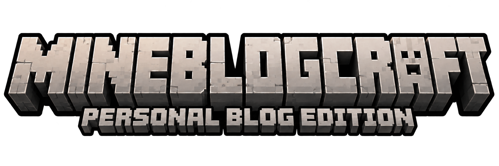
</a>

**把学习、写作与知识整理，建成一个可以探索的方块世界。**

一个以 Minecraft Java 版界面语言构建的个人技术网站。<br />
围绕 AI、网络安全与软件工程，连接博客、RSS、论文与个人 Wiki。

[访问网站](https://jonhyblog-jonhyblog-d2ggh3rc306480701.webapps.tcloudbase.com/) · [功能导览](#功能导览) · [快速开始](#快速开始) · [技术架构](#技术架构) · [开发路线](#开发路线)


</div>

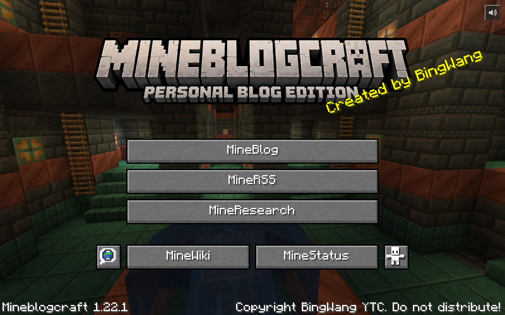

## 关于项目

我希望个人网站既能承载严肃的技术内容，也能保留探索的乐趣。MineBlogcraft 将熟悉的游戏交互转化为知识入口：文章像一个个可以进入的世界，论文收藏在书架上，概念沿着进度树展开，个人介绍则收进创造模式物品栏。

网站以内容之间的关系为核心。博客记录主题与实践，RSS 汇集外部信息，论文提供研究原文，Wiki 将其中的重要知识整理成带来源的概念网络。每个版块有独立的阅读方式，也通过稳定的内容 ID 和引用关系彼此连接。

| 写作 | 信息输入 | 研究阅读 | 知识整理 |
| :---: | :---: | :---: | :---: |
| **22** 篇已审阅博客 | **21** 个 RSS 源 · **314** 条摘要 | **33** 篇真实论文 | **89** 个 Wiki 节点 |

以上为当前仓库内容规模；对应本次构建的统计可在站内 MineStatus 查看。论文覆盖 2024 年以来的 AI、网络安全与软件工程研究，每个方向各 11 篇。

## 功能导览

### 主菜单 · 从熟悉的世界开始

六面旋转全景、自定义石质 Logo、黄色 Splash、位图文字与像素按钮共同构成网站入口。主菜单保留游戏界面的层次和节奏，通过 GUI Scale 将逻辑坐标映射到不同分辨率。

- Three.js 绘制立方体全景，按帧时间旋转；页面隐藏时暂停动画，组件卸载时释放图形资源。
- 首次进入播放加载过渡；内容版块之间通过统一导航切换。
- 右上角喇叭控制菜单背景音乐，开关偏好保存在本机；有声播放遵循浏览器的用户交互策略。
- 常用控件支持键盘焦点与操作，内容页提供返回入口；纹理或 WebGL 加载失败时具备后备显示。

### 关于我 · 创造模式物品栏

个人介绍采用创造模式背包布局，以三维 Steve、钻石装备、物品标签和技能快捷栏呈现个人档案。模型随鼠标转动，背景延续草方块与泥土纹理，简介与站点说明融入物品栏面板。

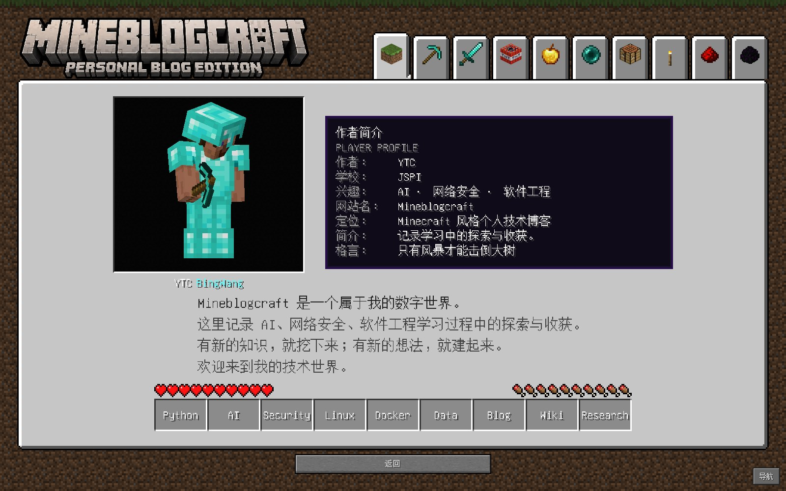

个人信息与网站介绍集中维护在 [`profile-config.ts`](src/config/profile-config.ts)，品牌、主菜单文字与 Logo 布局由 [`ui-config.ts`](src/config/ui-config.ts) 管理。

### MineBlog · 每篇文章，都是一个知识世界

MineBlog 借用单人游戏“选择世界”的交互组织文章。列表以原版主题物品区分内容，展示标题、栏目日期、分类、简介与审阅状态；可以搜索，也可以通过进入按钮、双击或键盘打开正文。

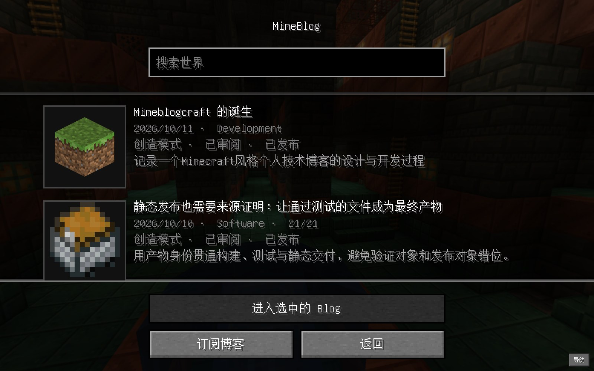

- **内容阅读**：Markdown 标题、段落、列表、引用与代码块，适配像素字体和长文滚动。
- **元数据**：栏目日期、修订时间与实际发布日期分别表达，保留标签、来源和审阅记录。
- **稳定链接**：文章通过 `#blog/<id>` 定位，支持直接访问与浏览器历史导航。
- **发布订阅**：列表中的“订阅博客”打开游戏风格说明弹窗，提供订阅地址、复制操作和阅读器使用步骤。

<details>
<summary><strong>查看文章阅读与订阅界面</strong></summary>

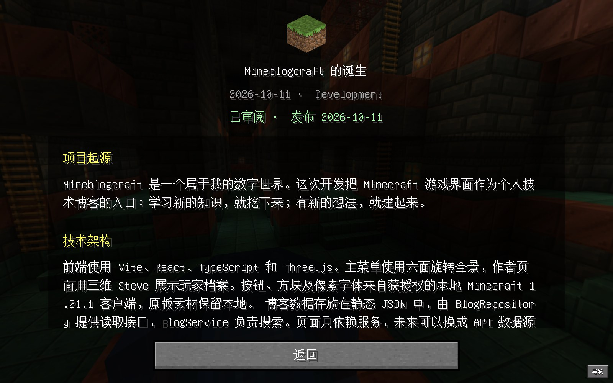

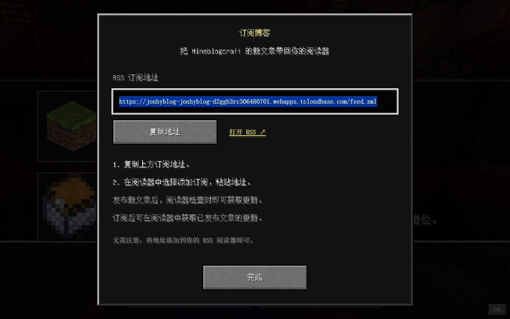

</details>

本站订阅源为 **[feed.xml](https://jonhyblog-jonhyblog-d2ggh3rc306480701.webapps.tcloudbase.com/feed.xml)**，构建时从已发布博客生成 RSS 2.0。把地址添加到 RSS 阅读器后，阅读器便可按自己的检查频率获取文章更新，无需注册账号。

### MineRSS · 把信息源放进服务器列表

外部订阅以多人游戏服务器列表的形式呈现。每个信息源具有独立物品图标、主题标签、地址与采集状态，覆盖 AI、网络安全和软件工程三个方向。

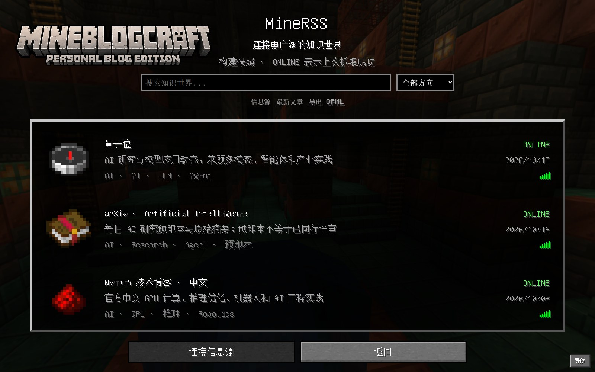

- 按方向筛选、搜索信息源，进入摘要阅读；可查看原始文章链接。
- 阅读状态保存在本机浏览器，便于继续浏览。
- 提供 [OPML 订阅列表](public/data/rss/subscriptions.opml)，便于将信息源迁移至其他阅读器。
- 采集工具处理 RSS / Atom、去重和来源记录；抓取失败时保留已有快照。

MineRSS 展示经过采集与保存的内容快照，更新时间与原文发表时间各有含义。外部信息采集通过显式脚本执行；本站文章的订阅入口则位于 MineBlog。

### MineResearch · 在书架与双页之间阅读研究

论文以附魔书陈列在书架中，检索台支持按标题、作者、关键词及相关主题查找。打开书籍后播放翻书过渡，进入双页原文阅读界面。

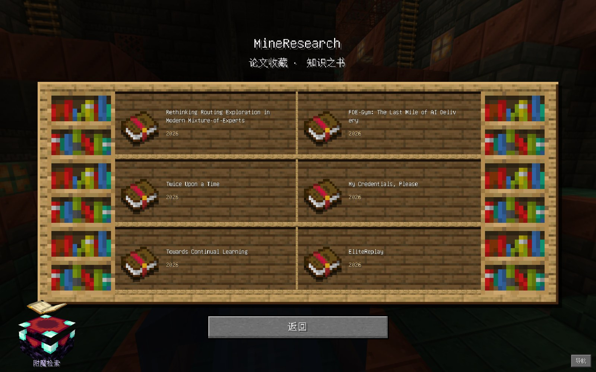

- **明确来源**：保留原作者、原始摘要、发表信息、来源链接与许可记录，区分预印本和正式发表论文。
- **完整原文**：当前 33 篇论文包含 32 份原始 PDF 与 1 份出版方结构化全文。
- **双页阅读**：支持上一页、下一页、页码跳转与键盘翻页；PDF 页面通过 PDF.js 渲染。
- **细节查看**：原文页可重新以高分辨率绘制后放大，结构化全文支持图表原图查看。
- **可追溯收录**：来源配置、文件完整性与哈希校验纳入构建流程，候选论文与正式书架分开维护。

<details>
<summary><strong>查看双页原文阅读界面</strong></summary>

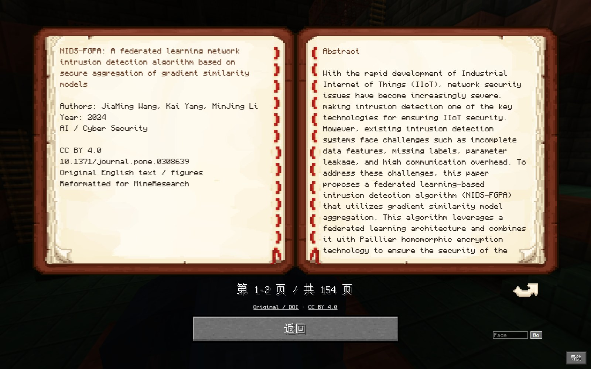

</details>

### MineWiki · 有来源的知识进度树

MineWiki 将站内博客、RSS 摘要和论文中的重要知识组织为 AI、Security、Software、Modeling 四个分支，以 Minecraft 进度界面的节点、连线和物品图标呈现概念关系。

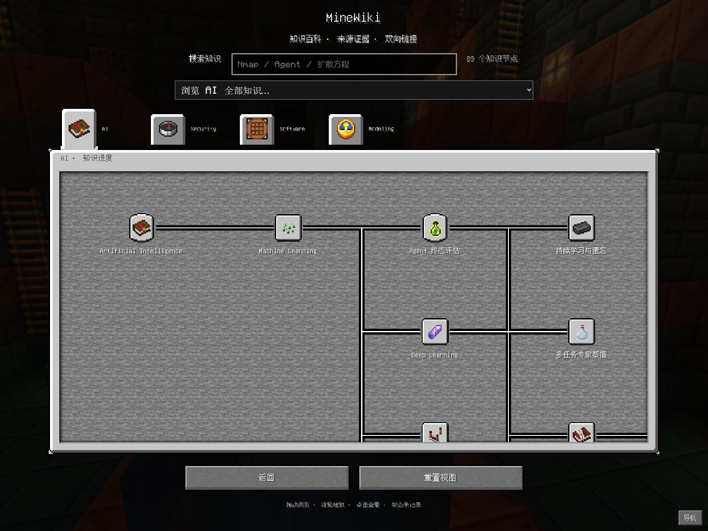

- **探索知识**：拖拽与缩放画布，查看前置关系，按分支浏览或使用知识目录定位。
- **全文检索**：标题、别名、标签、正文及来源参与加权匹配，支持中英文检索与一定程度的拼写容错。
- **正文与证据**：节点包含分节正文、目录、学习要点、图标选择理由、来源摘录和定位信息。
- **双向链接**：相关概念与反向链接共同组织阅读路径，并连接对应博客、论文和 RSS 源。
- **文件化维护**：Markdown 是内容源，构建脚本生成前端索引，检查 ID、引用和前置关系中的环。

<details>
<summary><strong>查看知识详情、目录与来源组织</strong></summary>

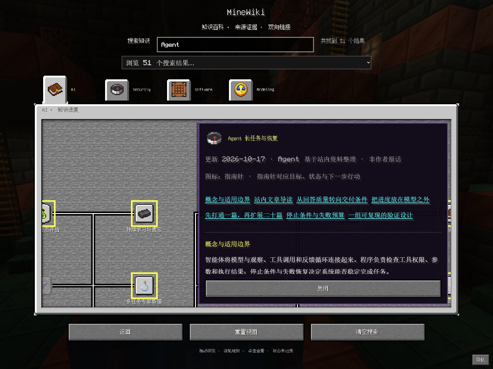

</details>

知识整理保留作者记录、Agent 整理和外部资料之间的归属。仓库还提供基于 Wiki 证据的检索与问答工作流：由开发环境中的 Agent 调用资料，按来源回答；网站本身运行本地检索，不在浏览器中保存模型密钥。

### MineStatus · 让构建状态有据可查

附魔台式状态页将内容统计、构建标识和校验结果组织成可查看详情的词条。数据来自构建脚本生成的报告，包含时间、提交号、运行标识及检查记录。

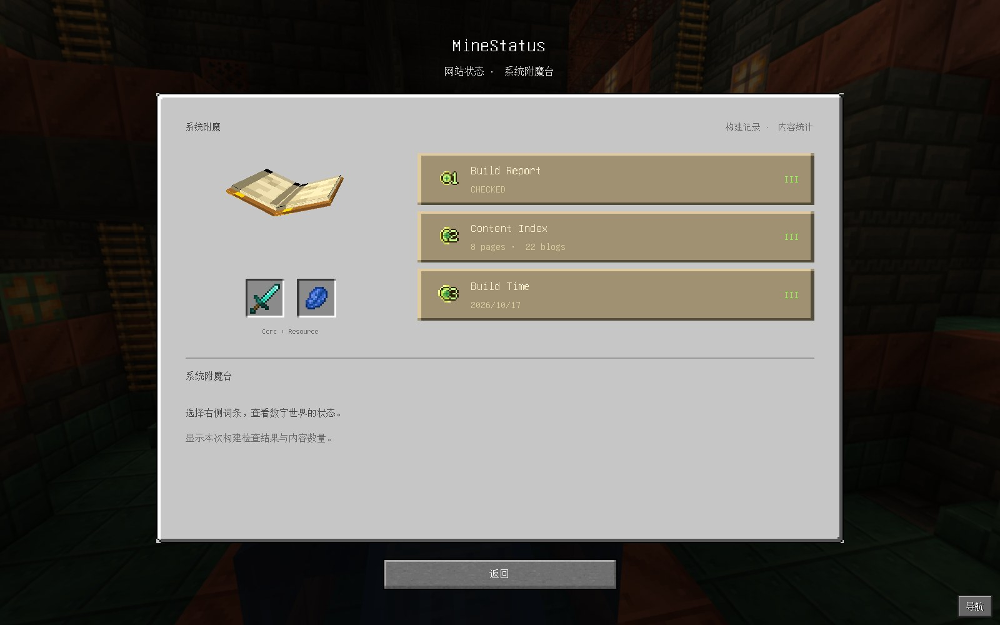

MineStatus 用于回答“这份网站产物包含什么、何时构建、通过了哪些检查”。线上发布另以 `deployment.json` 记录目标提交，两者共同帮助核对构建与发布的版本。

### MineWorld · 在浏览器中放置第一块方块

主菜单的地球图标进入 MineWorld。该版块集成自托管的 **ClassiCube Web 客户端**，提供独立的 Minecraft Classic 单机体验，包含世界生成、第一人称移动与方块交互。

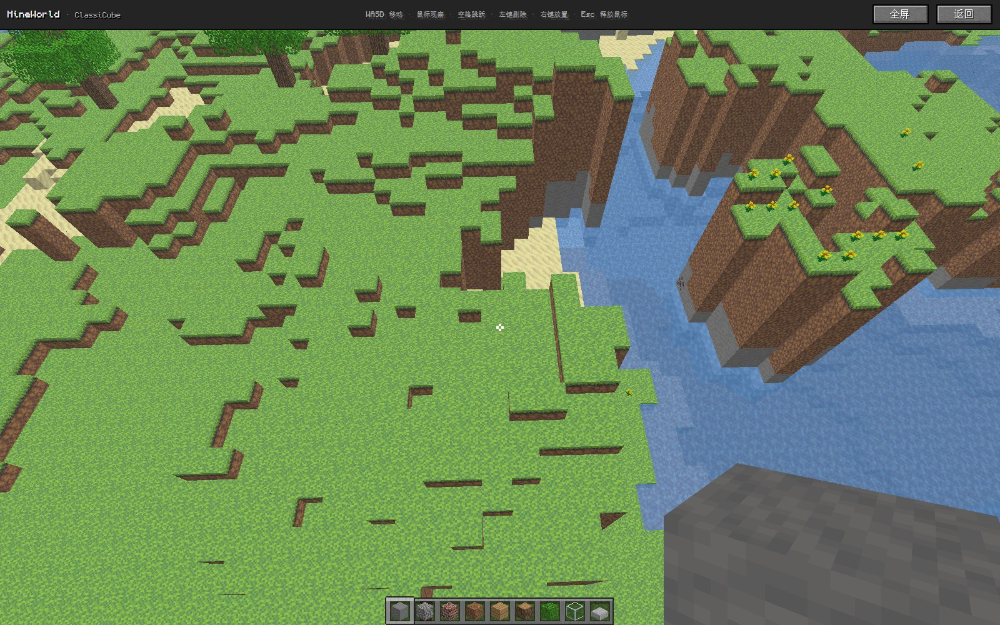

| 操作 | 按键 |
| --- | --- |
| 移动 / 观察 | `W A S D` / 鼠标 |
| 跳跃 | `Space` |
| 删除 / 放置方块 | 鼠标左键 / 右键 |
| 释放鼠标 | `Esc` |
| 全屏 / 返回网站 | 顶部工具栏 |

游戏客户端与博客界面隔离运行，桥接消息校验来源及状态。上游引擎、许可证和来源记录保留完整，项目适配脚本在构建时生成独立客户端副本，原始上游文件保持可核验。

## 技术架构

### 界面、内容与工具分层

| 层次 | 技术与职责 |
| --- | --- |
| 应用界面 | React 19、TypeScript 5.9；功能页面、共享导航、阅读交互与异常恢复 |
| 图形与视觉 | Three.js、WebGL、Canvas 位图文字、CSS 像素布局；全景、人物与书本表现 |
| 内容服务 | Repository / Service 分层；博客、RSS、论文、Wiki 和构建报告读取 |
| 检索 | 浏览器端加权文本搜索、别名匹配与容错；稳定 ID 连接内容 |
| 文档阅读 | PDF.js、结构化论文正文、分页与图像查看 |
| 构建工具 | Vite 7、Node.js 脚本；资源核验、内容生成与静态产物构建 |
| 验证 | Node.js Test Runner、Playwright；内容约束、发布边界与浏览器交互回归 |
| 发布 | GitHub Actions → 腾讯云 CloudBase 静态托管；极狐 CI 配置用于构建校验 |

具体依赖版本由 [`package-lock.json`](package-lock.json) 锁定。

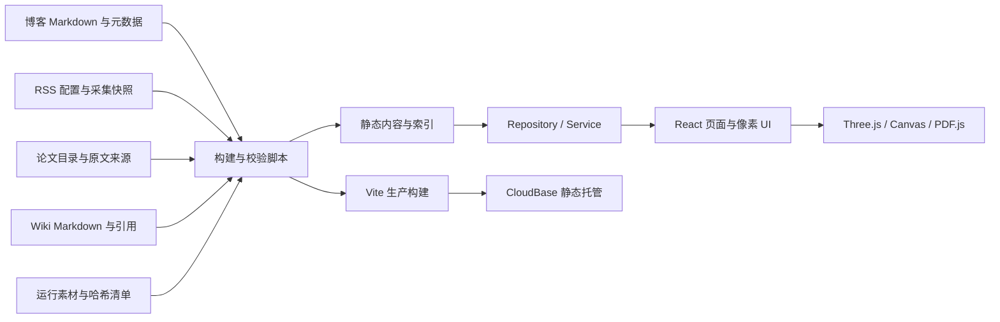

### 内容如何流动

1. **输入**：博客保存在仓库，外部 RSS 通过采集脚本形成快照，论文按来源与许可核验后收录。
2. **整理**：Wiki 使用稳定 ID、`[[id]]` 链接、来源摘录和关联记录组织概念。
3. **生成**：构建脚本编译 Wiki 与反向链接、生成 RSS、准备论文和阅读器资源。
4. **校验**：检查日期、路径、来源、链接协议、内容覆盖和资源完整性，再生成构建报告。
5. **呈现**：页面通过服务层读取内容，在游戏界面中完成阅读、检索与跨版块导航。

浏览器消费静态产物，内容更新和外部采集在工具链中完成。该结构让源码、内容与发布版本都可以通过 Git 和构建记录追溯。

### 安全与可靠性设计

- Markdown 与外部摘要以受控文本结构渲染，不执行嵌入的 HTML 或脚本。
- RSS 采集约束协议、域名、内网目标、跳转、体积和超时，拒绝 DTD / 实体声明。
- PDF 来源与资源文件通过既有白名单、元数据和完整性流程检查；阅读器不执行 PDF 脚本或动作。
- 游戏桥接校验消息来源和有效状态，内容页面设置异常恢复边界。
- 发布前运行检查与 Wiki 拖拽稳定性回归；发布过程保留版本标记，避免旧提交覆盖新版本。

检查结果应结合对应提交与实际运行记录理解；完整验收范围见 [验收记录](docs/FINAL_ACCEPTANCE.md)，Wiki 长时间使用的回归说明见 [稳定性修复记录](docs/WIKI_BLACKOUT_FIX.md)。

## 快速开始

### 环境要求

- Node.js **22.12+** 与 npm。
- Git；首次构建需要网络访问，以恢复运行素材和论文资源。
- 支持 WebGL 的现代浏览器；开发与自动化测试以 Chromium 为主要验证环境。

### 安装与运行

```bash
git clone https://github.com/johnnyhacker243-cmyk/mineblogcraft.git
cd mineblogcraft
npm ci
npm run build:cloud
npm run dev
```

打开终端显示的本地地址，默认为 `http://127.0.0.1:5173/`。

**首次克隆请先执行 `build:cloud`。** 原版运行素材未直接纳入 Git，脚本依据 [`cloud-assets.json`](cloud-assets.json) 下载并核验文件大小与 SHA-256，再进行生产构建。现有资源就绪后，日常开发可直接使用 `npm run dev`，普通构建使用 `npm run build`。资源恢复依赖当前清单中的托管地址，不能将“静态前端”理解为首次安装完全离线。

生产预览：

```bash
npm run build:cloud
npx vite preview --host 127.0.0.1
```

产物位于 `dist/`。Windows PowerShell 如遇 `npm.ps1` 执行限制，可使用 `npm.cmd` 与 `npx.cmd` 运行同样的命令。

## 开发与维护

### 目录结构

```text
mineblogcraft/
├── src/
│   ├── components/         共享 UI、全景、人物与阅读器组件
│   ├── screens/            博客、RSS、论文、Wiki 与状态页面
│   ├── MineWorld/          ClassiCube 容器、加载与消息桥接
│   ├── services/           内容仓库、检索与文档读取
│   ├── models/             内容及状态数据模型
│   ├── config/             品牌、布局、个人介绍与视觉配置
│   ├── data/               内容目录及生成的 Wiki 索引
│   └── styles/             各版块像素样式
├── content/wiki/           Wiki Markdown、引用与维护规则
├── public/
│   ├── content/blogs/      博客 Markdown
│   ├── data/rss/           RSS 快照、采集记录与 OPML
│   ├── papers/             论文正文、来源与许可记录
│   └── vendor/classicube/  上游客户端与许可证
├── config/                 RSS、论文来源与主题图标配置
├── scripts/                采集、生成、核验、发布与打包工具
├── tests/                  内容测试与浏览器交互回归
├── .opencode/skills/       Wiki 证据问答与论文收集工作流
└── docs/                   工程文档、交付指南与展示图片
```

完整入口与文件定位见 [源码导航](docs/SOURCE_INDEX.md)。

### 内容维护入口

| 修改内容 | 维护位置与约定 |
| --- | --- |
| 品牌与个人介绍 | `src/config/ui-config.ts`、`src/config/profile-config.ts` |
| 博客 | `public/content/blogs/` 与 `src/data/blogs.json`；正文和元数据保持一致 |
| 外部订阅 | `config/rssSources.json`；采集结果保存在 `public/data/rss/` |
| 论文 | `config/researchSelection.json`、`config/paperFulltextSources.json`；核验来源、完整性与许可后收录 |
| Wiki | `content/wiki/*.md`；维护稳定 ID、更新时间、标签、双向链接与证据 |
| 主题物品 | `config/` 下的博客、RSS、Wiki 图标映射与导入工具 |

常用命令：

```bash
# 更新外部 RSS 快照并检查
npm run rss:fetch
npm run rss:validate

# 重建 Wiki 索引与反向链接
node scripts/build-wiki.mjs

# 从已有 Wiki 中查找证据
node scripts/search-wiki.mjs "Agent"

# 采集近期论文候选，核验后再决定是否收录
node scripts/collect-papers.mjs --query "all:AI agent" --days 30 --limit 10
```

采集命令会访问外部服务并更新对应数据文件；网络错误、限流和空结果应按实际情况处理，保留已有内容。Wiki 写作约定见 [`content/wiki/README.md`](content/wiki/README.md)。

### 检查与回归

```bash
npm run build:cloud
npm run test:content
npm run test:world
node --test tests/cloud-assets.test.mjs tests/cloudbase-publish.test.mjs
node scripts/release-audit.mjs
```

浏览器测试另需安装 Chromium，并保持开发服务器运行：

```bash
npx playwright install chromium
npm run dev
```

在另一终端执行所需用例：

```bash
npm run test:blog
npm run test:rss
npm run test:research
npm run test:wiki-stability
```

浏览器用例默认访问 `http://127.0.0.1:5173/`；Wiki 稳定性脚本支持通过 `TEST_BASE_URL` 指定地址，默认包含连续交互与持续使用检查。截图、日志及个人缓存按 `.gitignore` 保留在本地；README 展示图单独位于 `docs/media/`。

## 构建与发布

GitHub 的 `main` 分支由现有 Actions 工作流执行构建、内容测试、Wiki 浏览器回归，再将通过校验的静态产物发布到腾讯云 CloudBase。发布过程核对目标提交，并通过公网 `deployment.json` 确认版本。

```text
main 提交 → 资源核验 → 生产构建 → 内容与浏览器回归
         → 差异上传静态产物 → 核对线上提交
```

- [GitHub 发布配置](.github/workflows/cloudbase-deploy.yml)：现有网站发布入口。
- [极狐校验配置](.gitlab-ci.yml)：源码构建与测试，不重复部署同一网站。
- [源码交付说明](docs/GITLAB_SOURCE_DELIVERY.md)：干净目录运行、素材范围与源码打包。
- [极狐提交与部署指南](docs/极狐GitLab提交与腾讯云部署完整指南.md)：保留现有发布或迁移发布方的完整步骤。

部署目录使用 `dist/`，云端凭据保存在平台的秘密变量中。切换发布平台时，应先停用原发布流程，确保同一网站只有一个发布方。

## 开发路线

项目沿着“界面还原 → 内容承载 → 知识连接 → 可验证交付”的顺序演进。下表概括已完成的能力与后续方向，具体实现以当前源码为准。

| 阶段 | 交付重点 | 状态 |
| --- | --- | :---: |
| 视觉与交互基础 | 游戏主菜单、全景、Logo、位图字体、GUI Scale、个人物品栏 | 已完成 |
| 内容阅读 | Markdown 博客、文章元数据、稳定链接、RSS 发布与外部阅读 | 已完成 |
| 研究资料 | 三领域论文目录、完整原文、书架检索、双页阅读与来源核验 | 已完成 |
| 知识网络 | 文件化 Wiki、物品节点、全文检索、双向链接、站内资料关联 | 已完成 |
| 体验整合 | 菜单音乐、统一导航、MineWorld、页面恢复与多尺寸适配 | 已完成 |
| 工程交付 | 构建报告、内容与安全边界检查、浏览器回归、CloudBase 发布与源码包 | 已完成 |

后续工作将围绕内容质量和阅读体验持续演进：

- **内容更新**：保持博客、论文和 Wiki 的来源、时间及引用关系一致，扩展主题前先完成资料核验。
- **检索体验**：改进大规模知识节点下的相关性、定位与导航，让资料之间的联系更易发现。
- **性能与适配**：继续优化图谱分包、长文阅读、PDF 渲染与不同输入设备的操作体验。
- **证据辅助**：在既有检索接口与 Agent 工作流上探索带引用的辅助阅读；需要模型服务时另行设计服务端凭据与访问边界。

后续方向属于规划，不纳入当前网站的在线能力声明。早期设计与模块研究保留在工程文档中，便于追溯决策。

## 文档索引

| 文档 | 内容 |
| --- | --- |
| [源码导航](docs/SOURCE_INDEX.md) | 页面入口、数据文件与工具定位 |
| [Wiki 维护规则](content/wiki/README.md) | 节点结构、双向链接与来源约定 |
| [论文原文说明](PAPER_FULLTEXT.md) | 原文来源、PDF 阅读与相关工程记录 |
| [验收记录](docs/FINAL_ACCEPTANCE.md) | 功能对应关系、检查范围与实际验证结果 |
| [Wiki 稳定性](docs/WIKI_BLACKOUT_FIX.md) | 黑屏问题修复与回归依据 |
| [源码交付](docs/GITLAB_SOURCE_DELIVERY.md) | 干净构建、归档和提交边界 |
| [素材来源](ASSET_LICENSES.md) | 自定义资源、游戏素材与第三方内容的许可范围 |

## 致谢与素材说明

界面设计受到 Minecraft Java 版启发；MineBlogcraft 与 Mojang、Microsoft 没有官方关联。Minecraft 的名称、商标、游戏图像和音频归其权利人所有。自定义 Logo、项目展示截图与原版素材分别遵循其适用的使用范围，不能据此将第三方素材视为自由再分发资源。

感谢 [ClassiCube](https://github.com/ClassiCube/ClassiCube)、[PDF.js](https://github.com/mozilla/pdf.js)、[Three.js](https://github.com/mrdoob/three.js)、[Monocraft](https://github.com/IdreesInc/Monocraft) 及相关开源项目。论文、外部文章与 RSS 内容保留原作者、出版方和来源归属。

具体来源、许可证与资源提交范围见 [ASSET_LICENSES.md](ASSET_LICENSES.md)；各上游组件的许可证随对应文件保留。

---

<div align="center">

**有新的知识，就挖下来；有新的想法，就建起来。**

[进入 MineBlogcraft](https://jonhyblog-jonhyblog-d2ggh3rc306480701.webapps.tcloudbase.com/)

</div>
